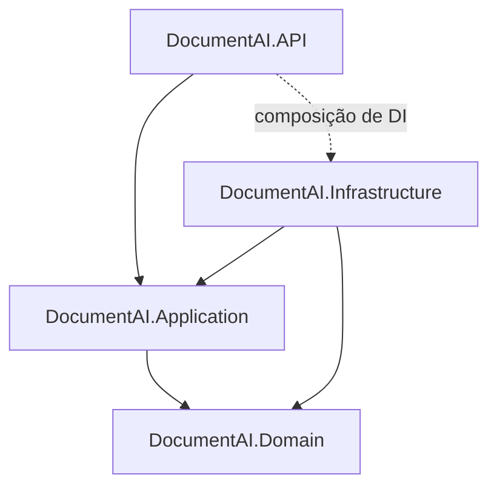

# DocumentAI

API corporativa em ASP.NET Core para análise inteligente de documentos com OpenAI.

O cliente envia o título e o conteúdo textual de um documento e recebe uma análise em JSON estruturado: tipo do documento, resumo objetivo, palavras-chave, nível de risco (`BAIXO`, `MEDIO` ou `ALTO`) e pontos de atenção.

> **Status:** solution e estrutura de projetos criadas, com a documentação web (Scalar) publicada. Os endpoints e a integração com a OpenAI ainda estão em implementação. O andamento fica em [docs/tasks.md](docs/tasks.md).

---

## Sumário

- [Visão geral da API](#visão-geral-da-api)
- [Stack](#stack)
- [Arquitetura](#arquitetura)
- [Estrutura do repositório](#estrutura-do-repositório)
- [Documentação (SDD)](#documentação-sdd)
- [Agent Skills e instruções para agentes](#agent-skills-e-instruções-para-agentes)
- [Configuração](#configuração)
- [Como executar](#como-executar)
- [Testes](#testes)
- [CI/CD](#cicd)
- [Regras de contribuição](#regras-de-contribuição)

---

## Visão geral da API

| Método | Rota | Finalidade |
|--------|------|------------|
| `POST` | `/api/documentos/analisar` | Analisa um documento com IA |
| `GET` | `/health` | Informa se a aplicação está em execução e configurada |

### Exemplo

Requisição:

```http
POST /api/documentos/analisar
Content-Type: application/json

{
  "titulo": "Contrato de prestação de serviços de suporte de TI",
  "conteudo": "CONTRATO DE PRESTAÇÃO DE SERVIÇOS ... multa de 50% do valor remanescente ..."
}
```

Resposta `200 OK`:

```json
{
  "tipoDocumento": "Contrato",
  "resumo": "Contrato de suporte técnico de TI por 12 meses, com renovação automática e multa rescisória de 50%.",
  "nivelRisco": "MEDIO",
  "palavrasChave": ["prestação de serviços", "suporte de TI", "multa rescisória"],
  "pontosAtencao": [
    "Multa rescisória elevada: 50% do valor remanescente do contrato.",
    "Renovação automática sem prazo definido para manifestação contrária."
  ]
}
```

### Códigos de resposta

| Status | Situação |
|--------|----------|
| `200` | Análise concluída |
| `400` | Dados inválidos (campos obrigatórios, limites de tamanho, JSON malformado) |
| `405` / `413` / `415` | Método não permitido / corpo maior que 256 KB / Content-Type diferente de JSON |
| `502` | Falha ou resposta inválida do serviço de IA |
| `503` | Serviço de IA não configurado |
| `504` | Tempo limite do serviço de IA excedido |
| `500` | Erro interno inesperado |

Todos os erros seguem o formato Problem Details (RFC 9457) e trazem um `traceId` para localizar a requisição nos logs. O contrato completo, com validações, exemplos e JSON Schema, está em [docs/specifications.md](docs/specifications.md).

---

## Stack

| Tema | Tecnologia |
|------|------------|
| Plataforma | .NET 10, ASP.NET Core Web API com Controllers |
| IA | SDK oficial da OpenAI para .NET, com Structured Outputs (`json_schema` estrito) |
| Testes | xUnit, `WebApplicationFactory`, coverlet |
| CI/CD | GitHub Actions, com autenticação no Azure por OIDC |
| Hospedagem | Azure App Service, com credenciais no Azure Key Vault |

---

## Arquitetura

A solution segue uma arquitetura em camadas, com as dependências sempre apontando para o domínio:



| Projeto | Responsabilidade |
|---------|------------------|
| `DocumentAI.API` | Controllers, contrato HTTP, tratamento centralizado de exceções, Health Check e composição do DI |
| `DocumentAI.Application` | Caso de uso de análise, DTOs, validação de entrada e interfaces (portas) para serviços externos |
| `DocumentAI.Domain` | Modelo `AnaliseDocumento`, nível de risco, normalização e regras de negócio. Não depende de nenhum pacote externo |
| `DocumentAI.Infrastructure` | Integração com a OpenAI (Structured Outputs, tempo limite, tradução de erros) e configuração |
| `DocumentAI.Tests` | Testes unitários, de integração, de arquitetura e de qualidade da IA |

O detalhamento das camadas, do fluxo de requisição, do tratamento de erros e da estratégia de testes está em [docs/architecture.md](docs/architecture.md).

---

## Estrutura do repositório

```
.
├── .agents/skills/          Agent Skills do projeto
├── .github/workflows/       Pipeline de CI/CD (GitHub Actions)
├── docs/                    Documentação SDD
│   ├── requirements.md
│   ├── architecture.md
│   ├── specifications.md
│   └── tasks.md
├── src/
│   ├── DocumentAI.API/
│   ├── DocumentAI.Application/
│   ├── DocumentAI.Domain/
│   └── DocumentAI.Infrastructure/
├── tests/
│   └── DocumentAI.Tests/
├── AGENTS.md                Instruções para agentes de IA
├── Directory.Build.props    Propriedades comuns de build (.NET 10, nullable, analisadores)
├── DocumentAI.sln
├── global.json              Versão do SDK do .NET
└── README.md
```

---

## Documentação (SDD)

O projeto segue *Spec-Driven Development*: nenhum código é escrito antes de os documentos serem aprovados.

| Documento | Conteúdo |
|-----------|----------|
| [requirements.md](docs/requirements.md) | Requisitos funcionais e não funcionais, com critérios de aceite verificáveis |
| [architecture.md](docs/architecture.md) | Camadas, dependências permitidas, fluxo, credenciais, erros, testes e decisões pendentes |
| [specifications.md](docs/specifications.md) | Contrato HTTP, validações, integração com a OpenAI, critérios de aceite e cenários de teste |
| [tasks.md](docs/tasks.md) | Plano de implementação em tarefas pequenas, com dependências e critérios de conclusão |

---

## Agent Skills e instruções para agentes

O [AGENTS.md](AGENTS.md) define as regras para agentes de IA que trabalham neste repositório: ler `docs/` antes de implementar, implementar apenas requisitos aprovados, não armazenar credenciais no código, executar build e testes antes de concluir e não fazer deploy sem autorização.

| Skill | Finalidade | Quando usar |
|-------|------------|-------------|
| [dotnet-architecture](.agents/skills/dotnet-architecture/SKILL.md) | Manter o código alinhado à arquitetura | Ao criar ou alterar código de produção |
| [dotnet-testing](.agents/skills/dotnet-testing/SKILL.md) | Verificar os requisitos com testes xUnit | Ao criar, revisar ou executar testes |
| [azure-deployment](.agents/skills/azure-deployment/SKILL.md) | Padronizar a publicação no Azure | Ao trabalhar no pipeline e no deploy |

---

## Configuração

Nenhuma credencial é armazenada no repositório.

| Configuração | Variável de ambiente | Obrigatória | Padrão |
|--------------|----------------------|-------------|--------|
| Chave da OpenAI | `OPENAI_API_KEY` (ou `OpenAI__ApiKey`) | sim | — |
| Modelo | `OpenAI__Modelo` | sim | definido em `appsettings.json` |
| Tempo limite (segundos) | `OpenAI__TempoLimiteSegundos` | não | `60` |

- **Desenvolvimento local:** `dotnet user-secrets` no projeto `DocumentAI.API` ou a variável `OPENAI_API_KEY`.
- **Azure:** Application Settings do App Service com referência ao Key Vault, acessado pela Managed Identity.

Sem a chave, a aplicação inicia normalmente, mas `GET /health` retorna `503` (`Unhealthy`).

---

## Como executar

Pré-requisito: [SDK do .NET 10](https://dotnet.microsoft.com/download).

```bash
dotnet build
```

```bash
dotnet user-secrets set "OpenAI:ApiKey" "<sua-chave>" --project src/DocumentAI.API
```

```bash
dotnet run --project src/DocumentAI.API --launch-profile https
```

A configuração da chave é necessária só quando a integração com a OpenAI estiver implementada.

### Documentação interativa (Scalar)

A API publica uma documentação web para ler o contrato e testar os endpoints, **em desenvolvimento e em produção**:

| Recurso | Desenvolvimento | Produção |
|---------|-----------------|----------|
| Scalar | https://localhost:7041/scalar | `https://<app>.azurewebsites.net/scalar` |
| Documento OpenAPI | https://localhost:7041/openapi/v1.json | `https://<app>.azurewebsites.net/openapi/v1.json` |

Pelo Visual Studio, o perfil de execução já abre o Scalar no navegador.

---

## Testes

```bash
dotnet test
```

- Os testes unitários e de integração **não** chamam a OpenAI: a integração é simulada, e os testes rodam sem chave.
- A suíte de qualidade da IA usa a OpenAI real e é ignorada automaticamente quando `OPENAI_API_KEY` não está definida. Para executá-la:

```bash
dotnet test --filter Categoria=QualidadeIA
```

- Cobertura mínima de 80% na camada de aplicação.

---

## CI/CD

O workflow [.github/workflows/ci-cd.yml](.github/workflows/ci-cd.yml) tem três jobs encadeados:

| Job | Executa em | Situação atual |
|-----|------------|----------------|
| `build` | push e pull request na `main` | **ativo**: instala o SDK do `global.json`, restaura e compila a solution em `Release` |
| `test` | depois do `build` | **ativo**: executa `dotnet test` sem a suíte `QualidadeIA` e publica os resultados (`.trx`) como artefato |
| `deploy` | depois do `test`, apenas em push na `main` | esqueleto: só imprime mensagens; nenhum recurso do Azure é alterado |

O restante (cobertura mínima, varredura de segredos e publicação no Azure App Service via OIDC com aprovação manual) está planejado nas tarefas 10.3 a 10.5 de [docs/tasks.md](docs/tasks.md).

---

## Regras de contribuição

1. Leia os documentos em `docs/` e o [AGENTS.md](AGENTS.md) antes de implementar.
2. Implemente apenas tarefas de [docs/tasks.md](docs/tasks.md) com dependências concluídas.
3. Toda funcionalidade nova vem acompanhada de testes.
4. Execute `dotnet build` e `dotnet test` antes de abrir um pull request.
5. Mudanças de requisito ou de arquitetura exigem aprovação e atualização dos documentos.
