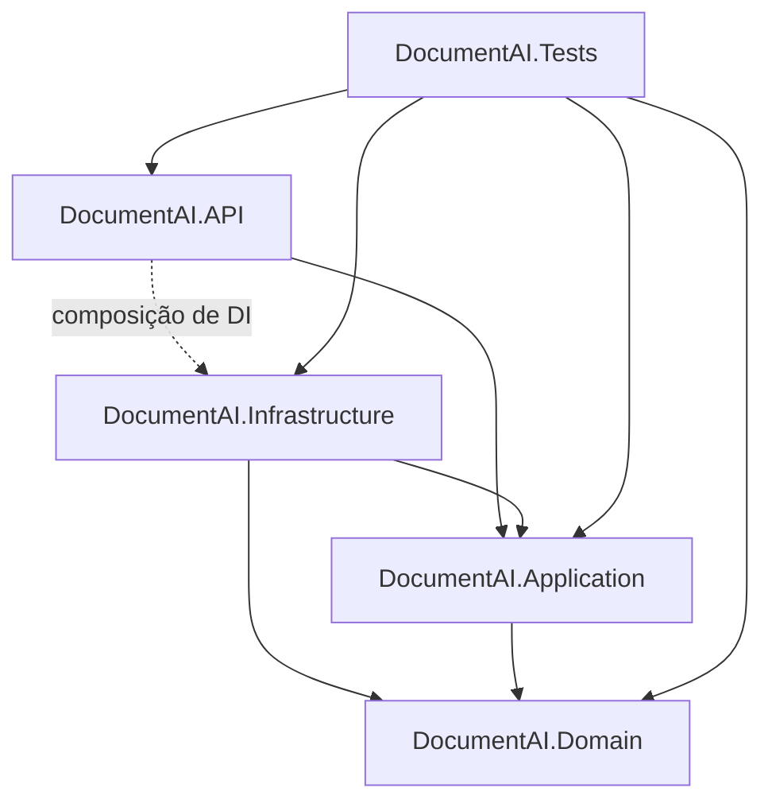
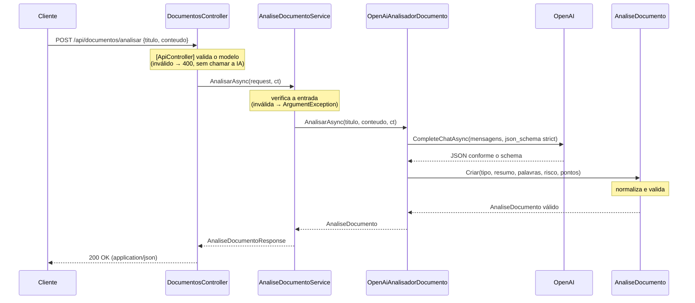

# Arquitetura — DocumentAI

## 1. Visão geral

O DocumentAI é uma API ASP.NET Core (.NET 10) organizada em camadas, no estilo *Clean Architecture*. O domínio e as regras de negócio ficam no centro e não dependem de frameworks. A integração com a OpenAI fica na borda, atrás de uma interface definida pela camada de aplicação.

Este documento descreve **como** os requisitos de [requirements.md](requirements.md) serão atendidos. Os contratos detalhados (JSON Schema, mensagens, prompts) ficam em [specifications.md](specifications.md).

Escolhas tecnológicas:

| Tema | Escolha |
|------|---------|
| Plataforma | .NET 10, ASP.NET Core com **Controllers** (`[ApiController]`) |
| Composição | **Dependency Injection** nativa do ASP.NET Core |
| Integração com IA | **SDK oficial da OpenAI para .NET** (pacote NuGet `OpenAI`), usando `ChatClient` |
| Formato da resposta da IA | **Structured Outputs**: `response_format` do tipo `json_schema` com `strict: true` |
| Erros | `IExceptionHandler` + `ProblemDetails` (RFC 9457) |
| Configuração | Options pattern (`IOptions<T>`) + variáveis de ambiente |
| Tempo e prazos | `TimeProvider` (nativo do .NET), injetado onde há tempo limite |
| Health Check | `Microsoft.Extensions.Diagnostics.HealthChecks` |
| Documentação da API | `Microsoft.AspNetCore.OpenApi` (OpenAPI nativo do .NET) + **Scalar** (`Scalar.AspNetCore`) como interface web de testes, disponíveis em **todos os ambientes** (decisão D-15) |
| Testes | **xUnit**, `Microsoft.AspNetCore.Mvc.Testing` (`WebApplicationFactory`), coverlet |

---

## 2. Estrutura da solution

```
DocumentAI.sln                        (ver decisão D-01)
├── src/
│   ├── DocumentAI.API/               ASP.NET Core Web API (Microsoft.NET.Sdk.Web)
│   ├── DocumentAI.Application/       Casos de uso, DTOs, interfaces (portas)
│   ├── DocumentAI.Domain/            Entidades, value objects, regras de negócio
│   └── DocumentAI.Infrastructure/    Implementação da integração com a OpenAI
├── tests/
│   └── DocumentAI.Tests/             xUnit: unitários, integração, arquitetura, qualidade da IA
└── docs/
```

A solution se chama `DocumentAI.sln`, o mesmo nome dos projetos e do [AGENTS.md](../AGENTS.md) (decisão D-01, aplicada). O SDK é fixado por `global.json` (.NET 10, `rollForward: latestFeature`).

Configuração de build comum:
- todos os projetos têm `TargetFramework` igual a `net10.0` (CA-N01.1), com `Nullable` e `ImplicitUsings` habilitados;
- `TreatWarningsAsErrors` fica ligado nos projetos de `src/`;
- o analisador `Microsoft.VisualStudio.Threading.Analyzers` trata como erro de build o bloqueio síncrono (`.Result`, `.Wait()`, `GetAwaiter().GetResult()`), o que verifica o CA-N02.2 sem depender de testes.

---

## 3. Responsabilidades das camadas

### 3.1 DocumentAI.Domain

O núcleo do sistema. É código C# puro, sem dependência de ASP.NET, OpenAI ou qualquer pacote NuGet externo.

**Responsabilidades:**
- Modelar o resultado de uma análise como um objeto de domínio válido por construção (`AnaliseDocumento`).
- Definir o enum `NivelRisco` (`Baixo`, `Medio`, `Alto`), que corresponde a `BAIXO`, `MEDIO` e `ALTO` no contrato (RF-06).
- Definir as **constantes de limites** do negócio numa única classe estática (`LimitesDocumento`): 200 caracteres para o título, 50.000 para o conteúdo, 1.000 para o resumo e 10 palavras-chave. As DataAnnotations da Application, as invariantes do domínio e as instruções ao modelo na Infrastructure usam essas constantes, e nenhum desses números é repetido em outro lugar.
- **Normalizar** os dados recebidos na fábrica de `AnaliseDocumento`, antes de validar. A normalização é regra de negócio e vale para qualquer provedor de IA:
  - remover espaços no início e no fim de todos os textos;
  - remover itens vazios de `palavrasChave` e `pontosAtencao`;
  - remover palavras-chave repetidas, comparando sem diferenciar maiúsculas e minúsculas e mantendo a primeira ocorrência;
  - manter só as 10 primeiras palavras-chave;
  - usar `"Indeterminado"` quando `tipoDocumento` vier vazio (CA-03.3).
- Garantir, depois da normalização, as invariantes que não dependem de quem produz os dados:
  - `resumo` não vazio e com no máximo 1.000 caracteres (CA-04.1, CA-04.2);
  - `palavrasChave` com 1 a 10 itens, sem vazios e sem repetidos (CA-05.2);
  - `pontosAtencao` nunca nulo e com pelo menos 1 item quando o risco é `Medio` ou `Alto` (CA-07.2, CA-07.3);
  - `tipoDocumento` não vazio (CA-03.1).
- Sinalizar uma violação de invariante com uma exceção de domínio própria (`DomainValidationException`).

**Não faz:** E/S, logging, serialização JSON, validação de requisição HTTP.

### 3.2 DocumentAI.Application

Orquestra os casos de uso. Define **o que** a aplicação precisa do mundo externo por meio de interfaces (portas), sem saber como elas são implementadas.

**Responsabilidades:**
- Expor o caso de uso de análise pela interface `IAnaliseDocumentoService`, com o método `AnalisarAsync(AnalisarDocumentoRequest, CancellationToken)`.
- Definir os DTOs de entrada (`AnalisarDocumentoRequest`) e saída (`AnaliseDocumentoResponse`), que são o contrato público da API (seção 2 de requirements.md).
- Definir as regras de validação da entrada (RF-02) com DataAnnotations nos DTOs (decisão D-06): obrigatoriedade e limites de `titulo` e `conteudo`, usando as constantes de `LimitesDocumento`. O `[ApiController]` executa essas regras e devolve `400` com todos os erros juntos.
- **Proteger o caso de uso** contra entrada inválida, independentemente de quem o chama. O `AnaliseDocumentoService` verifica, antes de chamar a IA, se título e conteúdo estão preenchidos e dentro dos limites. Se não estiverem, lança `ArgumentException` sem chamar a porta. Pela API, essa situação nunca ocorre, porque a validação acontece antes; se ocorrer, indica erro de programação e resulta em `500`.
- Definir a porta `IAnalisadorDocumentoIa`, que recebe título e conteúdo e devolve um `AnaliseDocumento` de domínio.
- Definir as exceções de aplicação que o tratamento centralizado converte em status HTTP:
  - `IaIndisponivelException`: falha de comunicação ou erro da OpenAI → `502`;
  - `RespostaIaInvalidaException`: resposta fora do contrato, recusa do modelo ou violação de invariante do domínio → `502`;
  - `TempoLimiteIaException`: tempo limite excedido → `504`;
  - `IaNaoConfiguradaException`: credencial ausente → `503` (ver decisão D-09).
- Mapear `AnaliseDocumento` (domínio) para `AnaliseDocumentoResponse` (DTO), incluindo a conversão de `NivelRisco` para `"BAIXO"`/`"MEDIO"`/`"ALTO"`.
- Fornecer o método de extensão `AddApplication(this IServiceCollection)` para registrar seus serviços no DI.

**Não faz:** chamadas HTTP, acesso a SDKs externos, leitura de variáveis de ambiente.

### 3.3 DocumentAI.Infrastructure

Implementa as portas da Application usando tecnologias concretas. Nesta versão, só a integração com a OpenAI.

**Responsabilidades:**
- Implementar `IAnalisadorDocumentoIa` em `OpenAiAnalisadorDocumento`, usando o `ChatClient` do SDK oficial.
- Montar as mensagens enviadas ao modelo: instruções de sistema e documento do usuário, com o conteúdo delimitado e tratado como dado, não como instrução (mitigação de *prompt injection*). Os limites citados nas instruções vêm de `LimitesDocumento`.
- Configurar **Structured Outputs** com `ChatResponseFormat.CreateJsonSchemaFormat(...)`, `jsonSchemaIsStrict: true`, e o JSON Schema da análise:
  - todos os campos obrigatórios e `additionalProperties: false`;
  - `nivelRisco` como `enum: ["BAIXO", "MEDIO", "ALTO"]`, o que impede o modelo de gerar valores fora do domínio (CA-06.1).
- Tratar os casos em que o Structured Outputs não garante um resultado utilizável:
  - **recusa do modelo** (`ChatCompletion.Refusal` preenchido) → `RespostaIaInvalidaException`;
  - **resposta truncada** (`FinishReason` diferente de `Stop`, por exemplo por limite de tokens) → `RespostaIaInvalidaException`;
  - **JSON que não pode ser desserializado** → `RespostaIaInvalidaException`.
- Desserializar o JSON da IA e passar os valores, **sem tratá-los**, à fábrica de `AnaliseDocumento`, que normaliza e valida. Uma `DomainValidationException` é convertida em `RespostaIaInvalidaException`.
- Aplicar o tempo limite (padrão de 60 s) com um `CancellationTokenSource` criado a partir do `TimeProvider` injetado e ligado ao token da requisição. O `TimeProvider` permite testar o tempo limite sem esperas reais. O código distingue:
  - cancelamento pelo cliente → propaga `OperationCanceledException` (CA-N02.4);
  - tempo limite → `TempoLimiteIaException`.
- Converter exceções do SDK (`ClientResultException`, falhas de rede) em `IaIndisponivelException`, sem repassar a mensagem original para fora.
- Definir `OpenAiOptions` e o Health Check de configuração (`OpenAiConfiguracaoHealthCheck`).
- Fornecer o método de extensão `AddInfrastructure(this IServiceCollection, IConfiguration)`.

**Não faz:** regras de negócio (inclusive normalização dos dados da IA), validação de requisição, montagem de respostas HTTP.

### 3.4 DocumentAI.API

A camada de entrada HTTP e a **raiz de composição** (*composition root*) da aplicação.

**Responsabilidades:**
- `Program.cs`: registrar serviços (`AddApplication`, `AddInfrastructure`, `AddControllers`, `AddProblemDetails`, `AddExceptionHandler`, `AddHealthChecks`, `AddOpenApi`) e configurar o pipeline de middlewares.
- `DocumentosController`, com a action `POST /api/documentos/analisar`:
  - `[ApiController]`, para validação automática do modelo e resposta `400` em `ValidationProblemDetails` (CA-02.5, CA-02.6);
  - `[Consumes("application/json")]`, para retornar `415` em outros tipos de conteúdo (CA-01.2);
  - `[RequestSizeLimit]` de 256 KB, para rejeitar com `413` corpos muito maiores que o necessário antes de desserializá-los. O padrão do Kestrel é 30 MB; 256 KB acomoda 50.000 caracteres mesmo com acentos e escapes JSON;
  - `[ProducesResponseType]` para 200, 400, 413, 415, 500, 502, 503 e 504, e comentários XML, para documentar o contrato no OpenAPI e no Scalar (CA-08.5);
  - depende apenas de `IAnaliseDocumentoService`;
  - recebe `CancellationToken` (associado a `HttpContext.RequestAborted`) e o repassa.
- `GlobalExceptionHandler : IExceptionHandler`: o ponto único de tratamento de exceções (seção 7).
- Expor a documentação web em todos os ambientes (decisão D-15): o documento OpenAPI em `/openapi/v1.json` e a interface do Scalar em `/scalar`. A configuração fica em `OpenApi/DocumentacaoApiExtensions.cs`:
  - a descrição geral da API (contrato, códigos de status, formato de erro e roteiro de testes) é um arquivo Markdown incorporado ao assembly (`OpenApi/descricao-api.md`);
  - o documento OpenAPI não declara servidores, para que o Scalar envie as requisições à mesma origem da página, em DEV e em PROD, inclusive atrás do proxy HTTPS do App Service;
  - os recursos de nuvem da Scalar (ferramentas de desenvolvedor, assistente de IA, MCP, geração de SDK) e a telemetria ficam desligados.
- Mapear o Health Check em `GET /health` com um *response writer* que expõe apenas o status (CA-09.5).
- Configurar a serialização JSON: camelCase e UTF-8 (CA-01.5, CA-08.1).
- Expor `public partial class Program` para os testes de integração com `WebApplicationFactory<Program>`.

**Não faz:** regras de negócio, chamadas diretas à OpenAI, uso de tipos concretos da Infrastructure fora do `Program.cs`.

### 3.5 DocumentAI.Tests

Um único projeto xUnit, organizado por pastas (ver decisão D-02 e seção 8).

### 3.6 Registro no DI e tempo de vida dos serviços

| Serviço | Implementação | Tempo de vida | Registrado por | Motivo |
|---------|---------------|---------------|----------------|--------|
| `IAnaliseDocumentoService` | `AnaliseDocumentoService` | *scoped* | `AddApplication` | Um por requisição; não guarda estado. |
| `IAnalisadorDocumentoIa` | `OpenAiAnalisadorDocumento` | *singleton* | `AddInfrastructure` | Não guarda estado por requisição e depende apenas de *singletons*. |
| `ChatClient` | SDK da OpenAI | *singleton*, criado no primeiro uso | `AddInfrastructure` | Recomendação do SDK: é *thread-safe* e reaproveita conexões. A criação tardia permite iniciar sem a chave (seção 6.3). |
| `IOptions<OpenAiOptions>` | Options pattern | *singleton* | `AddInfrastructure` | Configuração lida uma vez. |
| `TimeProvider` | `TimeProvider.System` | *singleton* | `AddInfrastructure` | Substituído nos testes por uma implementação controlável. |
| `OpenAiConfiguracaoHealthCheck` | — | *singleton* | `AddInfrastructure` | Só lê `IOptions<OpenAiOptions>`. |
| `GlobalExceptionHandler` | — | *singleton* | `Program.cs` | Exigência de `AddExceptionHandler`. |

**Regra:** um serviço *singleton* nunca depende de um serviço *scoped*. A validação de escopos do contêiner (`ValidateScopes` e `ValidateOnBuild`) fica ligada em `Development` e nos testes de integração para detectar violações.

---

## 4. Referências permitidas entre projetos



| Projeto | Pode referenciar | Não pode referenciar |
|---------|------------------|----------------------|
| Domain | nenhum projeto; nenhum pacote externo | Application, Infrastructure, API |
| Application | Domain; apenas `Microsoft.Extensions.DependencyInjection.Abstractions`, para `AddApplication` | Infrastructure, API, pacote `OpenAI`, ASP.NET Core |
| Infrastructure | Application, Domain; pacote `OpenAI`; `Microsoft.Extensions.*` | API |
| API | Application, Infrastructure | — |
| Tests | todos | — |

**Regras complementares:**
- A dependência sempre aponta para dentro: API → Application → Domain. A Infrastructure depende da Application (implementa suas portas); a Application **nunca** depende da Infrastructure (inversão de dependência).
- A API referencia a Infrastructure **apenas** para chamar `AddInfrastructure(...)` no `Program.cs`. Controllers e handlers não usam tipos da Infrastructure.
- Os tipos do SDK da OpenAI (`ChatClient`, `ChatCompletion` etc.) não saem da Infrastructure.
- A Application não registra logs: os logs ficam na Infrastructure (integração) e na API (erros). Se a Application passar a precisar de log, a inclusão de `Microsoft.Extensions.Logging.Abstractions` deve ser aprovada e registrada aqui.
- Essas regras são verificadas por **testes de arquitetura** (seção 8.4), que falham se uma referência proibida for adicionada.

---

## 5. Fluxo de uma requisição

### 5.1 Análise de documento — caminho de sucesso



Passo a passo:

1. O cliente envia `POST /api/documentos/analisar` com JSON.
2. O ASP.NET Core verifica o `Content-Type` (`415` se não for JSON) e o tamanho do corpo (`413` se passar de 256 KB), e desserializa o corpo (`400` se o JSON for malformado).
3. O `[ApiController]` executa a validação do modelo. Se houver erro, retorna `400` com `ValidationProblemDetails` listando todos os campos inválidos. **A action não é executada e a IA não é chamada** (CA-02.7).
4. O controller chama `IAnaliseDocumentoService.AnalisarAsync`, repassando o `CancellationToken`.
5. O serviço verifica a entrada (linha de defesa da seção 3.2) e chama a porta `IAnalisadorDocumentoIa`.
6. A Infrastructure monta as mensagens, aplica o tempo limite e chama a OpenAI com Structured Outputs.
7. A Infrastructure verifica recusa e truncamento, desserializa o JSON e entrega os valores à fábrica de `AnaliseDocumento`, que normaliza e valida as invariantes.
8. O serviço mapeia o objeto de domínio para o DTO de resposta.
9. O controller retorna `200 OK`.

### 5.2 Caminhos de erro

| Onde ocorre | Situação | Exceção | Resposta |
|-------------|----------|---------|----------|
| Pipeline do ASP.NET | Rota inexistente, método não permitido | — | `404`, `405` |
| Pipeline do ASP.NET | Content-Type inválido | — | `415` |
| Pipeline do ASP.NET | Corpo maior que 256 KB | `BadHttpRequestException` | `413` |
| Pipeline do ASP.NET | JSON malformado, validação | — | `400` (`ValidationProblemDetails`) |
| Application | Entrada inválida chegando ao serviço (erro de programação) | `ArgumentException` | `500` |
| Infrastructure | Chave da OpenAI ausente | `IaNaoConfiguradaException` | `503` |
| Infrastructure | Erro HTTP ou de rede da OpenAI | `IaIndisponivelException` | `502` |
| Infrastructure | Recusa, truncamento, JSON inválido, invariante violada | `RespostaIaInvalidaException` | `502` |
| Infrastructure | Tempo limite excedido | `TempoLimiteIaException` | `504` |
| Qualquer camada | Erro inesperado | qualquer outra | `500` |
| Qualquer camada | Cliente cancelou a requisição | `OperationCanceledException` | conexão encerrada, sem log de erro |

### 5.3 Health Check

`GET /health` → `OpenAiConfiguracaoHealthCheck` verifica apenas se a configuração obrigatória está presente (chave e modelo). Ele **não** chama a OpenAI, então não consome tokens (CA-09.3) e responde rapidamente (CA-09.4). A resposta contém só o status (`Healthy` ou `Unhealthy`), sem detalhes de configuração (CA-09.5).

---

## 6. Configuração de credenciais

### 6.1 Modelo de configuração

As opções ficam em uma classe `OpenAiOptions` na Infrastructure, ligada à seção `OpenAI` da configuração:

| Propriedade | Chave de configuração | Variável de ambiente | Obrigatória | Padrão |
|-------------|----------------------|----------------------|-------------|--------|
| `ApiKey` | `OpenAI:ApiKey` | `OPENAI_API_KEY` (ou `OpenAI__ApiKey`) | sim | — |
| `Modelo` | `OpenAI:Modelo` | `OpenAI__Modelo` | sim | definido em `appsettings.json` (decisão D-05) |
| `TempoLimiteSegundos` | `OpenAI:TempoLimiteSegundos` | `OpenAI__TempoLimiteSegundos` | não | `60` |

- **Chave da API:** o requisito CA-N04.1 fixa o nome `OPENAI_API_KEY`, que não segue a convenção hierárquica do .NET (`OpenAI__ApiKey`). A `AddInfrastructure` usa `OpenAI:ApiKey` quando preenchida e, caso contrário, lê `OPENAI_API_KEY`. As duas formas funcionam.
- **Modelo e tempo limite** ficam em `appsettings.json`, porque não são segredos, e podem ser sobrescritos por variável de ambiente sem recompilar (CA-N04.5).
- **Nenhum segredo** em `appsettings*.json` ou no repositório (CA-N04.2). A verificação é feita por varredura de segredos no CI (ex.: *secret scanning* do GitHub ou gitleaks).

### 6.2 Por ambiente

| Ambiente | Onde a chave fica |
|----------|-------------------|
| Desenvolvimento local | `dotnet user-secrets` no projeto `DocumentAI.API`, ou variável de ambiente `OPENAI_API_KEY` |
| Testes automatizados | não é necessária: a IA é simulada (CA-N06.3) |
| Testes de qualidade da IA | variável de ambiente `OPENAI_API_KEY` na máquina ou pipeline que os executa |
| Azure App Service | *Application Settings* do App Service, preferencialmente como **referência ao Azure Key Vault** (`@Microsoft.KeyVault(...)`), com acesso pela *Managed Identity* do App Service (CA-N07.4) |

### 6.3 Comportamento sem credencial

O CA-N04.3 exige que a aplicação **inicie** mesmo sem a chave, registre um erro claro e informe `Unhealthy` no Health Check. Por isso:
- **não** é usado `ValidateOnStart()`, que impediria a inicialização;
- na inicialização, a `AddInfrastructure`/`Program.cs` registra um log `Error` se a chave estiver ausente, sem expor o valor;
- o `ChatClient` é criado de forma tardia (fábrica *singleton* no DI), para que a falta da chave não quebre a montagem do contêiner;
- uma requisição de análise sem chave configurada gera `IaNaoConfiguradaException` → `503`.

### 6.4 Proteção da chave

- A chave nunca é registrada em log, nem incluída em respostas, mensagens de exceção ou no Health Check (CA-N04.4).
- `OpenAiOptions` não sobrescreve `ToString()` de forma que exponha a chave.
- O `ChatClient` é registrado como *singleton*. Ele é *thread-safe*, e um único cliente reaproveita conexões HTTP.

---

## 7. Tratamento de erros

### 7.1 Mecanismo

- `builder.Services.AddProblemDetails(...)` padroniza todas as respostas de erro em `application/problem+json`.
- `GlobalExceptionHandler : IExceptionHandler`, registrado com `AddExceptionHandler<GlobalExceptionHandler>()` e ativado com `app.UseExceptionHandler()`, é o **único** ponto de tratamento de exceções não tratadas (CA-N05.1). Não há `try/catch` nos controllers.
- Erros de validação do modelo são tratados pelo `[ApiController]` antes da action, também em formato Problem Details.
- Erros gerados pelo próprio framework, sem exceção e sem corpo (`404` de rota inexistente, `405` de método não permitido), são convertidos em Problem Details por `app.UseStatusCodePages()`, que usa o `IProblemDetailsService` registrado por `AddProblemDetails`. Assim, **toda** resposta de erro da API tem o mesmo formato, com exceção do Health Check, que tem contrato próprio (specifications.md, seção 5).

### 7.2 Mapeamento de exceções

| Exceção | Status | `title` | Nível de log |
|---------|--------|---------|--------------|
| `IaNaoConfiguradaException` | 503 | Serviço de IA não configurado | `Error` |
| `IaIndisponivelException` | 502 | Falha ao comunicar com o serviço de IA | `Error` |
| `RespostaIaInvalidaException` | 502 | Resposta inválida do serviço de IA | `Warning` |
| `TempoLimiteIaException` | 504 | Tempo limite do serviço de IA excedido | `Warning` |
| `BadHttpRequestException` | o `StatusCode` da exceção (`400`, ou `413` para corpo grande demais) | Requisição inválida / Corpo da requisição muito grande | `Warning` |
| `OperationCanceledException` com a requisição cancelada | — | (sem resposta) | `Information` |
| Qualquer outra | 500 | Erro interno | `Error` |

### 7.3 Regras

- **Sem vazamento de detalhes** (CA-N05.3): em produção, `detail` contém uma mensagem genérica, sem stack trace, nome de classe ou mensagem original da exceção. Em desenvolvimento, a exceção pode ser incluída para depuração.
- **Rastreabilidade** (CA-N05.4): toda resposta Problem Details recebe a extensão `traceId` (`Activity.Current?.Id ?? HttpContext.TraceIdentifier`), e o mesmo identificador aparece no log.
- **Conteúdo do documento fora do log** (CA-N05.6): nenhum log registra `titulo` ou `conteudo`. É permitido registrar o tamanho do conteúdo, a duração da chamada e o modelo usado.
- **Resposta bruta da IA fora da resposta HTTP** (CA-08.3): o JSON retornado pela OpenAI não é incluído nas respostas de erro. Pode ser registrado em log apenas em nível `Debug` e apenas em desenvolvimento, porque pode conter trechos do documento.

---

## 8. Estratégia de testes

### 8.1 Organização

```
tests/DocumentAI.Tests/
├── Unit/
│   ├── Domain/           Normalização e invariantes de AnaliseDocumento
│   ├── Application/      AnaliseDocumentoService, validação, mapeamentos
│   └── Infrastructure/   OpenAiAnalisadorDocumento com transporte HTTP simulado
├── Integration/          API completa em memória com WebApplicationFactory<Program>
├── Architecture/         Regras de dependência entre projetos
└── Quality/              Qualidade da IA com a OpenAI real (execução manual)
```

Ferramentas:
- **xUnit** (decisão D-10);
- `Microsoft.AspNetCore.Mvc.Testing`, para os testes de integração;
- coverlet, para cobertura;
- um validador de JSON Schema, exigido pelo CA-08.2;
- `Microsoft.Extensions.TimeProvider.Testing` (`FakeTimeProvider`), para avançar o relógio nos testes de tempo limite;
- uma biblioteca de *test doubles*, se necessária (decisão D-11).

Os testes de arquitetura não usam biblioteca adicional (seção 8.4).

### 8.2 Testes unitários

- **Domain:** a normalização e todas as invariantes da seção 3.1. Por exemplo: palavras-chave repetidas com caixas diferentes são reduzidas a uma, a 11ª palavra-chave é descartada, `tipoDocumento` vazio vira `"Indeterminado"`, resumo com 1.001 caracteres é rejeitado e risco `Alto` sem pontos de atenção é rejeitado.
- **Application:** o serviço chama a porta com os dados corretos, mapeia `NivelRisco` para `"BAIXO"`/`"MEDIO"`/`"ALTO"`, repassa o `CancellationToken` e propaga as exceções da porta sem alterá-las. Com entrada inválida, lança `ArgumentException` e não chama a porta.
- **Validação:** cada regra de RF-02 (nulo, vazio, só espaços, limite de tamanho, inclusive exatamente no limite).
- **Infrastructure:** o `ChatClient` recebe um `HttpClient` com um `HttpMessageHandler` simulado, por meio de `OpenAIClientOptions.Transport`. Isso testa o código real de integração **sem** acessar a OpenAI:
  - resposta válida → `AnaliseDocumento` correto;
  - a requisição enviada contém `response_format` `json_schema` com `strict: true` e o enum de risco;
  - recusa, `finish_reason: length`, JSON inválido, invariante violada → `RespostaIaInvalidaException`;
  - HTTP 500/429 da OpenAI → `IaIndisponivelException`;
  - atraso maior que o tempo limite → `TempoLimiteIaException`, com o relógio avançado pelo `FakeTimeProvider`, sem espera real;
  - cancelamento pelo cliente → `OperationCanceledException`, e não `TempoLimiteIaException`.

### 8.3 Testes de integração

`WebApplicationFactory<Program>` sobe a API em memória e substitui `IAnalisadorDocumentoIa` por um *fake* configurável (CA-N03.3). Rodam **sem** `OPENAI_API_KEY` (CA-N06.3), exceto o cenário que testa justamente a ausência da chave.

Cobrem os cenários de CA-N06.4 e o contrato HTTP:
- `200` com os cinco campos em camelCase, validado contra o JSON Schema (CA-08.1, CA-08.2);
- `400` para cada regra de validação, com todos os erros na mesma resposta; o *fake* registra que não foi chamado (CA-02.7);
- `400` para JSON malformado, `413` para corpo acima de 256 KB, `415` para outro Content-Type, `405` para outros métodos, todos em Problem Details;
- validação de escopos do DI ligada, para detectar *singletons* dependendo de serviços *scoped* (seção 3.6);
- `502` para resposta inválida e para indisponibilidade da IA; `504` para tempo limite; `500` para erro inesperado;
- respostas de erro sem stack trace e com `traceId`;
- `GET /health` → `200` com chave configurada e `503` sem chave;
- caracteres acentuados preservados (CA-01.5).

### 8.4 Testes de arquitetura

Verificam as regras da seção 4 com reflexão do próprio .NET, sem biblioteca adicional:
- `Assembly.GetReferencedAssemblies()` para as referências entre assemblies:
  - `DocumentAI.Domain` não referencia nenhum outro projeto nem pacote externo;
  - `DocumentAI.Application` não referencia `DocumentAI.Infrastructure`, `OpenAI` nem `Microsoft.AspNetCore.*`;
  - `DocumentAI.Infrastructure` não referencia `DocumentAI.API`;
- inspeção dos construtores dos controllers: nenhum parâmetro tem tipo definido em `DocumentAI.Infrastructure`.

A verificação de bloqueio síncrono (RNF-02) não é feita por testes, mas pelo analisador configurado como erro de build (seção 2).

### 8.5 Testes de qualidade da IA

Cobrem os critérios que dependem do comportamento do modelo (CA-03.2, CA-05.3, CA-06.3), usando a OpenAI real e um conjunto fixo de documentos de referência em `Quality/Fixtures/`.

- Marcados com `[Trait("Categoria", "QualidadeIA")]`.
- São **ignorados automaticamente** quando `OPENAI_API_KEY` não está definida. Assim, `dotnet test` na raiz passa em qualquer máquina e no CI (CA-N06.2).
- São executados sob demanda: `dotnet test --filter Categoria=QualidadeIA`.
- Avaliam limiares (ex.: 4 de 5 tipos corretos), não respostas exatas, porque a saída do modelo não é determinística.

### 8.6 Cobertura e CI

- Cobertura coletada com coverlet. Mínimo de 80% de linhas em `DocumentAI.Application` (CA-N06.5); recomenda-se a mesma meta para Domain e Infrastructure.
- O workflow de CI no GitHub Actions executa `dotnet build`, `dotnet test` (sem a categoria `QualidadeIA`), verificação de cobertura e varredura de segredos, nessa ordem.

---

## 9. Implantação (resumo)

- Azure App Service com runtime .NET 10 (CA-N07.1) e `HTTPS Only` habilitado (CA-N07.5).
- Health Check do App Service apontado para `/health` (CA-09.6).
- Credenciais em Application Settings, com referência ao Key Vault e Managed Identity (seção 6.2).
- Publicação reprodutível por workflows do **GitHub Actions**, com estágios separados de build, teste e deploy e autenticação no Azure por **federação OIDC**, sem segredo de longa duração (CA-N07.6; decisão D-13).
- **Logs:** a aplicação escreve no provedor de console padrão do ASP.NET Core. No App Service, os logs ficam disponíveis pelos recursos nativos, sem pacote adicional:
  - *App Service Logs* (*Application Logging*) habilitado, para acompanhar a inicialização e os erros pelo *Log stream*;
  - *Diagnostic settings* enviando `AppServiceConsoleLogs` e `AppServiceHTTPLogs` a um Log Analytics Workspace, quando for preciso guardar e consultar o histórico.

  O Application Insights fica como evolução opcional e exige aprovação, por acrescentar uma tecnologia.
- O detalhamento fica em [specifications.md](specifications.md) e [tasks.md](tasks.md).

---

## 10. Decisões arquiteturais que precisam de aprovação

Cada decisão traz uma recomendação. As escolhas descritas nas seções anteriores já seguem essas recomendações e mudam se a decisão for diferente.

### D-01 — Nome da solution e dos projetos — **aplicada**
**Contexto:** a solution criada se chama `DocumentoAI.sln`, os projetos se chamam `DocumentAI.*`, e requirements.md usa `DocumentoAI`. O [AGENTS.md](../AGENTS.md) define os projetos como `DocumentAI.*`, o que já descarta renomear os projetos.
**Opções:** (a) renomear a solution para `DocumentAI.sln` e padronizar tudo como `DocumentAI`; (b) manter `DocumentoAI.sln` com projetos `DocumentAI.*`.
**Recomendação:** (a). Um único nome evita confusão em namespaces, pacotes e no App Service. A seção 1 de requirements.md seria ajustada.

### D-02 — Um projeto de testes em vez de dois — **aplicada**
**Contexto:** o CA-N06.1 exige "pelo menos um projeto de testes unitários e um de integração", mas a estrutura pedida tem um único `DocumentAI.Tests`.
**Opções:** (a) um projeto com pastas `Unit/`, `Integration/`, `Architecture/` e `Quality/`, e o CA-N06.1 reescrito para exigir essas categorias, não projetos; (b) separar em `DocumentAI.UnitTests` e `DocumentAI.IntegrationTests`.
**Recomendação:** (a). É mais simples para o tamanho do projeto, e as categorias podem ser filtradas com `--filter`. Requer atualizar o CA-N06.1.

### D-03 — OpenAI direta ou Azure OpenAI
**Contexto:** o conteúdo dos documentos é enviado ao provedor de IA (ponto 6 de requirements.md). O Azure OpenAI oferece residência de dados, rede privada e autenticação por Managed Identity, sem chave.
**Opções:** (a) API pública da OpenAI com `OPENAI_API_KEY`; (b) Azure OpenAI (pacote `Azure.AI.OpenAI`, que usa o mesmo `ChatClient` do SDK `OpenAI`).
**Recomendação:** decidir com as áreas de segurança e jurídico. Se houver dados pessoais ou sigilosos, (b). A arquitetura isola a escolha na Infrastructure: a troca afeta apenas a criação do `ChatClient` e a configuração.

### D-04 — SDK da OpenAI direto ou `Microsoft.Extensions.AI`
**Contexto:** `Microsoft.Extensions.AI` (`IChatClient`) é uma abstração da Microsoft sobre vários provedores.
**Opções:** (a) usar o SDK `OpenAI` diretamente na Infrastructure; (b) usar `IChatClient`.
**Recomendação:** (a), como pedido. A porta `IAnalisadorDocumentoIa` já isola o provedor, e o SDK direto dá controle total sobre Structured Outputs, recusa e `finish_reason`.

### D-05 — Modelo padrão
**Contexto:** o modelo precisa suportar Structured Outputs com `strict: true`. A escolha afeta custo, latência (tempo limite de 60 s) e qualidade (CA-03.2, CA-06.3).
**Recomendação:** começar com um modelo de menor custo da família atual que suporte Structured Outputs, medir com a suíte `QualidadeIA` e subir de modelo apenas se os limiares não forem atingidos. O modelo é configurável (CA-N04.5), então a troca não exige nova versão.

### D-06 — Mecanismo de validação da entrada
**Opções:** (a) DataAnnotations (`[Required]`, `[MaxLength]`) nos DTOs da Application, validados automaticamente pelo `[ApiController]`; (b) FluentValidation na Application, chamado pelo serviço ou por um filtro.
**Recomendação:** (a). Cobre todas as regras de RF-02 sem dependência externa, gera `ValidationProblemDetails` com todos os erros e impede a chamada à IA. `[Required]` já rejeita strings vazias; para "só espaços", basta um atributo customizado simples. FluentValidation passa a valer a pena se as regras ficarem condicionais.

### D-07 — Política para respostas da IA fora das invariantes
**Contexto:** Structured Outputs garante a estrutura e o enum de risco, mas não garante tudo, por exemplo palavras-chave repetidas, resumo com mais de 1.000 caracteres ou risco `ALTO` sem pontos de atenção.
**Opções:** (a) rejeitar tudo com `502`; (b) normalizar o que é cosmético e rejeitar o que muda o significado; (c) tentar novamente a chamada uma vez antes de rejeitar.
**Recomendação:** (b), com a normalização na fábrica do domínio (seção 3.1). Normalizar: remover espaços extras, eliminar palavras-chave duplicadas ou vazias, limitar a 10 palavras-chave. Rejeitar com `502`: resumo vazio ou acima do limite, risco `MEDIO`/`ALTO` sem pontos de atenção. Os limites também são reforçados nas instruções ao modelo para reduzir a taxa de rejeição.

### D-08 — Novas tentativas e tempo limite
**Contexto:** o SDK da OpenAI repete automaticamente requisições que falham (ex.: 429 e 5xx). Sem coordenação, as tentativas podem ultrapassar os 60 s.
**Recomendação:** manter as novas tentativas do SDK, com no máximo 2, e aplicar os 60 s como prazo **total** da operação, incluindo as tentativas. Ao atingir o prazo, o resultado é `504`.

### D-09 — Status HTTP quando a credencial não está configurada
**Contexto:** os requisitos definem o comportamento do Health Check sem chave (`503`), mas não o de uma requisição de análise sem chave. A lista do CA-N05.2 não inclui esse caso.
**Opções:** (a) `503 Service Unavailable`; (b) `500 Internal Server Error`.
**Recomendação:** (a), por coerência com o Health Check. Requer acrescentar o caso a RF-08/RNF-05.

### D-10 — Versão do xUnit — **aplicada**
**Opções:** (a) xUnit v3; (b) xUnit v2.
**Decisão:** (a), com o *runner* VSTest (pacote `xunit.v3.mtp-off`), que mantém os comandos `dotnet test --filter` e `--collect` usados neste documento.
**Recomendação original:** (a). O v3 permite ignorar um teste em tempo de execução (`Assert.Skip`), que é o necessário para pular a suíte `QualidadeIA` sem chave (seção 8.5) sem extensões de terceiros.

### D-11 — Biblioteca de *test doubles*
**Opções:** (a) *fakes* escritos à mão; (b) NSubstitute; (c) Moq.
**Recomendação:** (a) para a porta `IAnalisadorDocumentoIa`, que é pequena e precisa de comportamentos configuráveis (sucesso, erro, atraso), e (b) se surgirem outras interfaces. Evitar (c) por causa da controvérsia de privacidade da versão 4.20, que costuma ser vetada em ambientes corporativos.

### D-12 — Autenticação dos clientes da API
**Contexto:** está fora do escopo em requirements.md (ponto 4), mas a API ficará exposta na internet pelo App Service, e cada chamada gera custo na OpenAI.
**Opções:** (a) Microsoft Entra ID (JWT) com `AddAuthentication().AddJwtBearer()`; (b) Azure API Management na frente da API; (c) autenticação integrada do App Service (*Easy Auth*); (d) API Key simples.
**Recomendação:** decidir **antes da publicação**. A arquitetura reserva o ponto de entrada: `UseAuthentication`/`UseAuthorization` no pipeline da API e `[Authorize]` no controller, sem impacto nas demais camadas. Na falta de definição, (a).

### D-13 — Plataforma de CI/CD — **resolvida**
**Decisão:** GitHub Actions, com autenticação no Azure por federação OIDC.
**Origem:** a stack do [AGENTS.md](../AGENTS.md) e a skill `azure-deployment` definem essa plataforma. Nenhuma aprovação adicional é necessária.

### D-14 — Provisionamento dos recursos do Azure
**Opções:** (a) infraestrutura como código com Bicep; (b) criação manual pelo portal ou pela CLI, com o passo a passo documentado.
**Recomendação:** (a). Torna o ambiente reprodutível e revisável em *pull request*. Como o AGENTS.md pede para não acrescentar tecnologias desnecessárias, a opção (b) é aceitável se houver um único ambiente.

### D-15 — Documentação web em todos os ambientes — **decidida pelo solicitante**
**Decisão:** Scalar como interface de documentação e testes, com o documento OpenAPI, disponível em DEV e em PROD (solicitação de 2026-10-20). Substitui a regra anterior de expor o OpenAPI apenas em desenvolvimento.
**Consequência:** enquanto a autenticação (D-12) não estiver definida, qualquer pessoa com a URL de produção consegue ver o contrato e enviar requisições pela página, o que gera custo na OpenAI. Quando D-12 for decidida, avaliar se `/scalar` e `/openapi/v1.json` em produção exigem autenticação.

---

## 11. Histórico de revisões

| Data | Revisão | Itens aplicados |
|------|---------|-----------------|
| 2026-10-20 | Criação da solution e dos projetos (tarefas 1.1–1.3 e 2.1) | D-01, D-02 e D-10 aplicadas. Nova decisão D-15: OpenAPI + Scalar em todos os ambientes (1, 3.4). |
| 2026-10-20 | Revisão com a skill `dotnet-architecture` | **V1** normalização movida da Infrastructure para o Domain (3.1, 3.3, 5.1). **V2** todos os erros do framework em Problem Details (7.1). **V3** verificação de entrada no serviço de aplicação (3.2, 5.1). **DI-1** removida a dependência de log da Application (4). **DI-2** testes de arquitetura por reflexão, sem NetArchTest (8.4). **I-1** rota `/api/documentos/analisar`. **I-2** nome da solution (2, D-01). **I-3** padrão `"Indeterminado"` só no Domain. **I-4** D-13 resolvida (9, 10). **I-5** analisadores movidos para a configuração de build (2). **M1** `TimeProvider` (1, 3.3, 8). **M2** constantes de limites no Domain (3.1). **M3** limite de 256 KB no corpo (3.4, 5). **M4** destino dos logs no Azure (9). **M5** tempos de vida no DI (3.6). Não aplicado: **M6** (*rate limiting*), por exigir requisito novo. |
