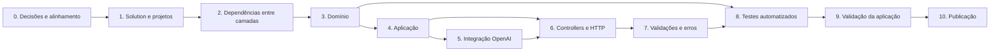

# Tarefas de implementação — DocumentAI

## 1. Como usar este documento

Este plano divide a implementação de [requirements.md](requirements.md), [architecture.md](architecture.md) e [specifications.md](specifications.md) em tarefas pequenas e ordenadas.

- **Identificação:** cada tarefa tem um número `fase.sequência` (ex.: **1.3**). Os códigos `T-xx` se referem aos cenários de teste de specifications.md, seção 6, e `CA-xx`/`CE-xx` aos critérios de aceite.
- **Dependências:** uma tarefa só começa quando todas as tarefas de que ela depende estão concluídas. Tarefas sem dependência entre si podem ser feitas em paralelo.
- **Conclusão:** uma tarefa só é concluída quando **todos** os seus critérios de conclusão estão marcados.
- **Regra geral, válida para todas as tarefas:** `dotnet build` termina sem erros e sem avisos, e os testes que já existem continuam passando.
- **Status:** `[ ]` pendente, `[x]` concluída.

> **A implementação não começa sem autorização explícita.** A fase 0 precisa ser concluída antes.

---

## 2. Visão geral

### 2.1 Fases

A fase 8 começa assim que existir algo testável: os testes de domínio (8.2) dependem apenas da fase 3. As tarefas de teste listam a dependência exata de cada uma.

### 2.2 Resumo das tarefas

| ID | Tarefa | Depende de |
|----|--------|------------|
| 0.1 | Aprovar as decisões arquiteturais | — |
| 0.2 | Alinhar os documentos de SDD | 0.1 |
| 1.1 | Inicializar o repositório | 0.2 |
| 1.2 | Configurar SDK e propriedades comuns de build | 1.1 |
| 1.3 | Criar a solution e os projetos | 1.2 |
| 2.1 | Configurar as referências entre projetos | 1.3 |
| 2.2 | Adicionar os pacotes NuGet | 2.1 |
| 2.3 | Criar os testes de arquitetura | 2.2 |
| 3.1 | Criar `NivelRisco` e `LimitesDocumento` | 2.1 |
| 3.2 | Criar `DomainValidationException` | 2.1 |
| 3.3 | Criar `AnaliseDocumento` com normalização e invariantes | 3.1, 3.2 |
| 4.1 | Criar os DTOs de requisição e resposta | 3.3 |
| 4.2 | Criar as exceções de aplicação | 2.1 |
| 4.3 | Definir a porta `IAnalisadorDocumentoIa` | 3.3 |
| 4.4 | Implementar `AnaliseDocumentoService` | 4.1, 4.2, 4.3 |
| 4.5 | Criar `AddApplication` | 4.4 |
| 5.1 | Criar `OpenAiOptions` e a leitura de credenciais | 2.2 |
| 5.2 | Registrar o `ChatClient` e criar `AddInfrastructure` | 5.1 |
| 5.3 | Definir o schema de Structured Outputs e as instruções | 2.2 |
| 5.4 | Implementar a chamada à OpenAI | 4.2, 4.3, 5.2, 5.3 |
| 5.5 | Implementar a conversão para o domínio | 5.4 |
| 5.6 | Implementar tempo limite, cancelamento e tradução de erros | 5.4 |
| 5.7 | Implementar o Health Check de configuração | 5.1 |
| 6.1 | Configurar o `Program.cs` | 4.5, 5.2 |
| 6.2 | Implementar `DocumentosController` | 6.1 |
| 6.3 | Mapear `GET /health` | 5.7, 6.1 |
| 6.4 | Expor OpenAPI apenas em desenvolvimento | 6.2 |
| 7.1 | Implementar as validações da requisição | 4.1, 6.2 |
| 7.2 | Padronizar as respostas Problem Details | 6.1 |
| 7.3 | Implementar `GlobalExceptionHandler` | 4.2, 7.2 |
| 7.4 | Aplicar a política de logs | 5.6, 7.3 |
| 8.1 | Criar a infraestrutura de testes | 2.2, 6.1 |
| 8.2 | Testes unitários de domínio e aplicação | 3.3, 4.4 |
| 8.3 | Testes unitários da integração com a OpenAI | 5.5, 5.6, 8.1 |
| 8.4 | Testes de integração: sucesso e validação | 7.1, 8.1 |
| 8.5 | Testes de integração: falhas e Health Check | 6.3, 7.3, 7.4, 8.1 |
| 8.6 | Suíte de qualidade da IA | 5.5, 8.1 |
| 8.7 | Medir e garantir a cobertura | 8.2, 8.3, 8.4, 8.5 |
| 9.1 | Validação local automatizada | 8.7 |
| 9.2 | Validação manual local com a OpenAI real | 9.1 |
| 9.3 | Executar a suíte de qualidade da IA | 8.6, 9.1 |
| 9.4 | Revisar a rastreabilidade dos requisitos | 9.2, 9.3 |
| 10.1 | Provisionar os recursos no Azure | 0.1, 9.4 |
| 10.2 | Configurar credenciais no Key Vault | 10.1 |
| 10.3 | Criar o pipeline de CI | 9.1 |
| 10.4 | Criar o pipeline de publicação | 10.2, 10.3 |
| 10.5 | Validar a aplicação publicada | 10.4 |

---

## 3. Tarefas

### Fase 0 — Decisões e alinhamento

#### 0.1 — Aprovar as decisões arquiteturais
**Depende de:** —

Obter aprovação para as decisões D-01 a D-12 de architecture.md, seção 10, e para as duas decisões de publicação abaixo, que ainda não estão em nenhum documento:

- **D-13 — Plataforma de CI/CD:** já resolvida pelo AGENTS.md: GitHub Actions com OIDC.
- **D-14 — Provisionamento do Azure:** infraestrutura como código (Bicep, recomendado) ou criação manual documentada.

As duas estão registradas em architecture.md, seção 10.

**Concluída quando:**
- [ ] Cada decisão pendente (D-01 a D-12 e D-14) tem uma opção escolhida e registrada em architecture.md, seção 10.
- [ ] As decisões que bloqueiam a publicação têm responsável e prazo definidos: D-03 (OpenAI ou Azure OpenAI) e D-12 (autenticação).

#### 0.2 — Alinhar os documentos de SDD
**Depende de:** 0.1

Corrigir as divergências conhecidas entre os documentos.

**Concluída quando:**
- [ ] A rota `/api/documentos/analisar` aparece em requirements.md, no lugar de `/api/documentos/analise`. O architecture.md já foi atualizado na revisão arquitetural.
- [ ] O aviso de mudança de rota na seção 1.1 do specifications.md foi removido.
- [ ] O nome do projeto é o mesmo nos três documentos (D-01).
- [ ] O CA-N06.1 está reescrito conforme D-02 (projeto único de testes com categorias).
- [ ] O `503` para chave ausente está incluído em RF-08 e RNF-05 (D-09).
- [ ] As decisões que mudaram em 0.1 estão refletidas em specifications.md, seções 1.3, 3.6 e 4.
- [ ] O requisito novo de *rate limiting* (melhoria M6 da revisão arquitetural) foi aprovado e incluído em requirements.md, ou explicitamente recusado.
- [ ] Uma busca por `analise"` e `/analise` nos documentos não encontra a rota antiga.

---

### Fase 1 — Solution e projetos

#### 1.1 — Inicializar o repositório
**Depende de:** 0.2

**Concluída quando:**
- [ ] A pasta é um repositório Git com um `.gitignore` para .NET (gerado por `dotnet new gitignore`).
- [ ] `.gitignore` exclui `bin/`, `obj/`, `.vs/`, `*.user` e `TestResults/`.
- [ ] O primeiro commit contém apenas `docs/`, a solution existente e o `.gitignore`.

#### 1.2 — Configurar SDK e propriedades comuns de build
**Depende de:** 1.1

**Concluída quando:**
- [ ] `global.json` fixa o SDK .NET 10 (`10.0.x`, com `rollForward: latestFeature`).
- [ ] `Directory.Build.props` na raiz define `TargetFramework` `net10.0`, `Nullable` `enable`, `ImplicitUsings` `enable` e `LangVersion` `latest`.
- [ ] Um `Directory.Build.props` em `src/` ativa `TreatWarningsAsErrors` apenas nos projetos de produção.
- [ ] O pacote de analisadores `Microsoft.VisualStudio.Threading.Analyzers` está configurado para todos os projetos, com as regras de bloqueio síncrono (`.Result`, `.Wait()`, `GetAwaiter().GetResult()`) como erro (CA-N02.2; architecture.md, seção 2).

#### 1.3 — Criar a solution e os projetos
**Depende de:** 1.2

**Concluída quando:**
- [ ] A solution tem o nome definido em D-01.
- [ ] Os projetos existem nas pastas de architecture.md, seção 2:
  - `src/DocumentAI.API` (template `webapi`, com Controllers);
  - `src/DocumentAI.Application` (`classlib`);
  - `src/DocumentAI.Domain` (`classlib`);
  - `src/DocumentAI.Infrastructure` (`classlib`);
  - `tests/DocumentAI.Tests` (xUnit, na versão definida em D-10).
- [ ] Os cinco projetos estão na solution, agrupados nas pastas de solution `src` e `tests`.
- [ ] O código de exemplo dos templates foi removido (`WeatherForecast`, `Class1`, `UnitTest1`).
- [ ] Os pacotes e arquivos de Swagger/Swashbuckle do template foram removidos (o OpenAPI nativo é configurado em 6.4).
- [ ] Nenhum projeto declara `TargetFramework` próprio: todos herdam `net10.0` do `Directory.Build.props` (CA-N01.1).
- [ ] `dotnet build` na raiz termina sem erros (CA-N01.3).
- [ ] A solution abre no Visual Studio com os cinco projetos carregados.

---

### Fase 2 — Dependências entre camadas

#### 2.1 — Configurar as referências entre projetos
**Depende de:** 1.3

Aplicar a tabela de architecture.md, seção 4.

**Concluída quando:**
- [ ] `Domain` não referencia nenhum projeto.
- [ ] `Application` referencia apenas `Domain`.
- [ ] `Infrastructure` referencia `Application` e `Domain`.
- [ ] `API` referencia `Application` e `Infrastructure`.
- [ ] `Tests` referencia os quatro projetos.
- [ ] `dotnet build` termina sem erros.

#### 2.2 — Adicionar os pacotes NuGet
**Depende de:** 2.1

**Concluída quando:**
- [ ] `Domain` não tem nenhum pacote.
- [ ] `Application` tem apenas `Microsoft.Extensions.DependencyInjection.Abstractions` (sem pacote de log; architecture.md, seção 4).
- [ ] `Infrastructure` tem `OpenAI` (ou `Azure.AI.OpenAI`, conforme D-03), `Microsoft.Extensions.Options.ConfigurationExtensions` e `Microsoft.Extensions.Diagnostics.HealthChecks`.
- [ ] `API` tem `Microsoft.AspNetCore.OpenApi`.
- [ ] `Tests` tem xUnit (D-10), `Microsoft.AspNetCore.Mvc.Testing`, `coverlet.collector`, uma biblioteca de validação de JSON Schema (CA-08.2), `Microsoft.Extensions.TimeProvider.Testing` e a biblioteca de *test doubles*, se houver (D-11).
- [ ] Não há biblioteca de testes de arquitetura: as regras são verificadas por reflexão (tarefa 2.3).
- [ ] Todas as versões estão fixadas e são estáveis (nenhuma prévia).
- [ ] `dotnet restore` e `dotnet build` terminam sem avisos de vulnerabilidade (`NU1901`–`NU1904`).

#### 2.3 — Criar os testes de arquitetura
**Depende de:** 2.2

Os testes criados aqui protegem as regras de dependência desde o início da implementação.

**Concluída quando:**
- [ ] Existe a pasta `tests/DocumentAI.Tests/Architecture/`.
- [ ] Os testes verificam as regras de architecture.md, seção 8.4, usando apenas reflexão do .NET (`Assembly.GetReferencedAssemblies()`):
  - `Domain` não referencia outros projetos nem pacotes externos;
  - `Application` não referencia `Infrastructure`, `OpenAI` nem `Microsoft.AspNetCore.*`;
  - `Infrastructure` não referencia `API`.
- [ ] Um teste verifica que nenhum construtor de controller recebe tipos de `DocumentAI.Infrastructure`. Ele passa trivialmente até a tarefa 6.2, quando os controllers passam a existir.
- [ ] Adicionar temporariamente uma referência proibida faz o teste falhar (verificado e desfeito).
- [ ] `dotnet test` termina sem falhas.

---

### Fase 3 — Domínio

#### 3.1 — Criar `NivelRisco` e `LimitesDocumento`
**Depende de:** 2.1

**Concluída quando:**
- [ ] O enum `NivelRisco` existe em `DocumentAI.Domain` com os valores `Baixo`, `Medio` e `Alto`.
- [ ] O enum não tem atributos de serialização nem dependência de outra camada.
- [ ] A classe estática `LimitesDocumento` define, como constantes, os limites de título (200), conteúdo (50.000), resumo (1.000) e quantidade de palavras-chave (10) (architecture.md, seção 3.1).
- [ ] Nenhum desses números aparece escrito diretamente em outro lugar do código de produção (verificável por busca).

#### 3.2 — Criar `DomainValidationException`
**Depende de:** 2.1

**Concluída quando:**
- [ ] A exceção existe em `DocumentAI.Domain` e informa qual regra foi violada, sem incluir o conteúdo do documento na mensagem.

#### 3.3 — Criar `AnaliseDocumento` com normalização e invariantes
**Depende de:** 3.1, 3.2

Objeto de domínio imutável, válido por construção (architecture.md, seção 3.1; specifications.md, seção 4.4, passos 4 e 5).

**Concluída quando:**
- [ ] Só é possível criar um `AnaliseDocumento` por uma fábrica que primeiro normaliza e depois valida.
- [ ] A normalização é aplicada nesta ordem:
  - remove espaços no início e no fim de todos os textos;
  - remove itens vazios de `palavrasChave` e `pontosAtencao`;
  - remove palavras-chave repetidas, sem diferenciar maiúsculas e minúsculas, mantendo a primeira ocorrência;
  - mantém só as 10 primeiras palavras-chave (limite de `LimitesDocumento`);
  - usa `"Indeterminado"` quando `tipoDocumento` está vazio.
- [ ] Depois da normalização, uma violação de invariante lança `DomainValidationException`:
  - `resumo` vazio ou acima do limite de `LimitesDocumento`;
  - `palavrasChave` nula ou vazia;
  - `pontosAtencao` nula;
  - risco `Medio` ou `Alto` com `pontosAtencao` vazia.
- [ ] As coleções expostas são somente leitura.
- [ ] A Infrastructure não tem nenhuma regra de normalização (tarefa 5.5).

---

### Fase 4 — Aplicação

#### 4.1 — Criar os DTOs de requisição e resposta
**Depende de:** 3.3

**Concluída quando:**
- [ ] `AnalisarDocumentoRequest` existe com `Titulo` e `Conteudo` (`string?`, para que a validação trate ausência e `null`).
- [ ] `AnaliseDocumentoResponse` existe com `TipoDocumento`, `Resumo`, `NivelRisco` (string), `PalavrasChave` e `PontosAtencao`.
- [ ] Os DTOs ficam em `DocumentAI.Application` e não dependem de ASP.NET Core.
- [ ] As regras de validação ainda **não** estão nos DTOs (são adicionadas em 7.1).

#### 4.2 — Criar as exceções de aplicação
**Depende de:** 2.1

**Concluída quando:**
- [ ] Existem `IaIndisponivelException`, `RespostaIaInvalidaException`, `TempoLimiteIaException` e `IaNaoConfiguradaException` em `DocumentAI.Application`.
- [ ] Cada uma aceita uma exceção interna, para preservar a causa no log.
- [ ] Nenhuma tem conhecimento de status HTTP (o mapeamento fica em 7.3).

#### 4.3 — Definir a porta `IAnalisadorDocumentoIa`
**Depende de:** 3.3

**Concluída quando:**
- [ ] A interface existe em `DocumentAI.Application` com o método `Task<AnaliseDocumento> AnalisarAsync(string titulo, string conteudo, CancellationToken cancellationToken)`.
- [ ] A documentação XML da interface lista as exceções de 4.2 que as implementações podem lançar.

#### 4.4 — Implementar `AnaliseDocumentoService`
**Depende de:** 4.1, 4.2, 4.3

**Concluída quando:**
- [ ] A interface `IAnaliseDocumentoService` e a implementação `AnaliseDocumentoService` existem.
- [ ] O serviço recebe `IAnalisadorDocumentoIa` por injeção no construtor (CA-N03.2, CA-N03.4).
- [ ] O serviço repassa título, conteúdo e `CancellationToken` à porta, sem alterá-los.
- [ ] O serviço mapeia `NivelRisco` para `"BAIXO"`, `"MEDIO"` e `"ALTO"`.
- [ ] As exceções da porta são propagadas sem serem capturadas ou alteradas.
- [ ] Antes de chamar a porta, o serviço verifica se título e conteúdo estão preenchidos e dentro dos limites de `LimitesDocumento`. Se não estiverem, lança `ArgumentException` e não chama a porta (architecture.md, seção 3.2; CE-14).
- [ ] O serviço é totalmente assíncrono (CA-N02.1).

#### 4.5 — Criar `AddApplication`
**Depende de:** 4.4

**Concluída quando:**
- [ ] O método de extensão `AddApplication(this IServiceCollection)` registra `IAnaliseDocumentoService` com tempo de vida *scoped* (architecture.md, seção 3.6).

---

### Fase 5 — Integração com a OpenAI

#### 5.1 — Criar `OpenAiOptions` e a leitura de credenciais
**Depende de:** 2.2

Implementar architecture.md, seção 6.

**Concluída quando:**
- [ ] `OpenAiOptions` existe com `ApiKey`, `Modelo` e `TempoLimiteSegundos` (padrão `60`).
- [ ] As opções são lidas da seção `OpenAI`. Quando `OpenAI:ApiKey` está vazia, é usada a variável `OPENAI_API_KEY` (CA-N04.1).
- [ ] `appsettings.json` da API contém `OpenAI:Modelo` (D-05) e `OpenAI:TempoLimiteSegundos`, e **nenhuma** chave.
- [ ] `ValidateOnStart` **não** é usado: a aplicação inicia sem a chave (CA-N04.3).
- [ ] Na inicialização, a ausência da chave gera um log `Error` claro, sem expor valores.
- [ ] `ToString()` de `OpenAiOptions` não expõe a chave.
- [ ] O projeto da API tem `UserSecretsId` para desenvolvimento local.

#### 5.2 — Registrar o `ChatClient` e criar `AddInfrastructure`
**Depende de:** 5.1

**Concluída quando:**
- [ ] O `ChatClient` é registrado como *singleton* por uma fábrica que só o cria quando é usado pela primeira vez, para que a falta da chave não quebre a montagem do DI.
- [ ] As novas tentativas do SDK estão limitadas a 2 (D-08).
- [ ] `AddInfrastructure(this IServiceCollection, IConfiguration)` registra as opções, o `ChatClient`, `TimeProvider.System`, `IAnalisadorDocumentoIa` → `OpenAiAnalisadorDocumento` e o Health Check.
- [ ] Todos os registros usam os tempos de vida da tabela de architecture.md, seção 3.6. `TimeProvider` é registrado com `TryAdd`, para que os testes possam substituí-lo.
- [ ] Os tipos do SDK da OpenAI não aparecem em nenhuma assinatura pública fora da Infrastructure.

#### 5.3 — Definir o schema de Structured Outputs e as instruções
**Depende de:** 2.2

**Concluída quando:**
- [ ] O schema de specifications.md, seção 4.3, está em um único lugar na Infrastructure (recurso incorporado ou constante).
- [ ] A mensagem de sistema atende aos 5 itens de specifications.md, seção 4.2, incluindo a defesa contra *prompt injection* e os critérios de risco.
- [ ] Os limites citados nas instruções vêm de `LimitesDocumento`.
- [ ] A mensagem de usuário delimita título e conteúdo com marcadores inequívocos.

#### 5.4 — Implementar a chamada à OpenAI
**Depende de:** 4.2, 4.3, 5.2, 5.3

**Concluída quando:**
- [ ] `OpenAiAnalisadorDocumento` implementa `IAnalisadorDocumentoIa`.
- [ ] A chamada usa `CompleteChatAsync` com `ChatResponseFormat.CreateJsonSchemaFormat(..., jsonSchemaIsStrict: true)`, temperatura baixa e limite de tokens de saída (specifications.md, seção 4.1).
- [ ] O `CancellationToken` é repassado ao SDK.
- [ ] Sem chave configurada, lança `IaNaoConfiguradaException` antes de tentar a chamada.
- [ ] Recusa (`Refusal`) → `RespostaIaInvalidaException`.
- [ ] `FinishReason` diferente de `Stop` → `RespostaIaInvalidaException`.
- [ ] JSON inválido ou incompleto → `RespostaIaInvalidaException`.

#### 5.5 — Implementar a conversão para o domínio
**Depende de:** 5.4

**Concluída quando:**
- [ ] Os valores desserializados da resposta da IA são passados, sem tratamento, à fábrica de `AnaliseDocumento` (a normalização é do domínio, tarefa 3.3).
- [ ] `DomainValidationException` é convertida em `RespostaIaInvalidaException`, preservando a causa.

#### 5.6 — Implementar tempo limite, cancelamento e tradução de erros
**Depende de:** 5.4

**Concluída quando:**
- [ ] O prazo total de `TempoLimiteSegundos` inclui as novas tentativas, com um `CancellationTokenSource` criado a partir do `TimeProvider` injetado e ligado ao token da requisição (D-08; architecture.md, seção 3.3).
- [ ] Nenhum ponto do código usa `DateTime.Now`, `Task.Delay` ou temporizadores sem passar pelo `TimeProvider`.
- [ ] Ao atingir o prazo, lança `TempoLimiteIaException`.
- [ ] O cancelamento pelo cliente propaga `OperationCanceledException`, e não `TempoLimiteIaException` (CA-N02.4).
- [ ] `ClientResultException` e falhas de rede são convertidas em `IaIndisponivelException`. O status HTTP original vai para o log, nunca para a mensagem da exceção.

#### 5.7 — Implementar o Health Check de configuração
**Depende de:** 5.1

**Concluída quando:**
- [ ] `OpenAiConfiguracaoHealthCheck` retorna `Healthy` quando a chave e o modelo estão preenchidos e `Unhealthy` quando falta algum.
- [ ] O Health Check não faz nenhuma chamada de rede (CA-09.3).
- [ ] A descrição do resultado não contém valores de configuração.

---

### Fase 6 — Controllers e contratos HTTP

#### 6.1 — Configurar o `Program.cs`
**Depende de:** 4.5, 5.2

**Concluída quando:**
- [ ] `Program.cs` registra `AddControllers`, `AddApplication`, `AddInfrastructure` e `AddHealthChecks`.
- [ ] A serialização JSON usa camelCase, aceita nomes sem diferenciar maiúsculas e minúsculas e ignora campos desconhecidos (specifications.md, seção 1.2).
- [ ] `UseHttpsRedirection` está ativo.
- [ ] A validação de escopos do DI (`ValidateScopes` e `ValidateOnBuild`) está ligada em `Development` (architecture.md, seção 3.6).
- [ ] `public partial class Program` está declarada para os testes de integração.
- [ ] Nenhum tipo da Infrastructure é usado no `Program.cs` além da chamada `AddInfrastructure`.
- [ ] A aplicação inicia localmente com `dotnet run`, com ou sem chave.

#### 6.2 — Implementar `DocumentosController`
**Depende de:** 6.1

**Concluída quando:**
- [ ] O controller tem `[ApiController]` e a action `POST /api/documentos/analisar`.
- [ ] A action tem `[Consumes("application/json")]`, `[RequestSizeLimit]` de 256 KB e `[ProducesResponseType]` para 200, 400, 413, 415, 500, 502, 503 e 504.
- [ ] A action recebe `CancellationToken` e o repassa a `IAnaliseDocumentoService`.
- [ ] O controller depende apenas de `IAnaliseDocumentoService` e não tem `try/catch`.
- [ ] Com um *fake* da porta, a requisição de exemplo de specifications.md, seção 3.1, retorna `200` com os cinco campos.
- [ ] `GET`, `PUT` e `DELETE` na rota retornam `405` com `Allow: POST`.

#### 6.3 — Mapear `GET /health`
**Depende de:** 5.7, 6.1

**Concluída quando:**
- [ ] `GET /health` retorna `{"status":"Healthy"}` com `200` ou `{"status":"Unhealthy"}` com `503` (specifications.md, seção 5.3).
- [ ] O corpo contém apenas o campo `status`.
- [ ] A resposta tem `Content-Type: application/json` e `Cache-Control: no-store, no-cache`.

#### 6.4 — Expor OpenAPI apenas em desenvolvimento
**Depende de:** 6.2

**Concluída quando:**
- [ ] `AddOpenApi` está registrado e `MapOpenApi` só é chamado no ambiente `Development`.
- [ ] O documento gerado descreve o request, o response e os status de 6.2 (CA-08.5).
- [ ] Fora de `Development`, `/openapi/v1.json` retorna `404`.
- [ ] Não existe nenhum endpoint além dos de specifications.md, seção 1.1 (CE-12).

---

### Fase 7 — Validações e tratamento de erros

#### 7.1 — Implementar as validações da requisição
**Depende de:** 4.1, 6.2

Implementar as regras V-01 a V-08 de specifications.md, seção 3.2, com o mecanismo definido em D-06.

**Concluída quando:**
- [ ] `Titulo` e `Conteudo` são obrigatórios, não aceitam texto só com espaços e respeitam os limites de 200 e 50.000 caracteres, lidos de `LimitesDocumento`.
- [ ] As mensagens são exatamente as de specifications.md, seção 3.2.
- [ ] Um campo que viola várias regras retorna apenas a primeira mensagem aplicável.
- [ ] As chaves de `errors` usam os nomes JSON em camelCase (`titulo`, `conteudo`).
- [ ] JSON malformado e tipos errados retornam `400` com a mensagem de V-01 ou V-08, sem expor detalhes do desserializador.
- [ ] Com uma requisição inválida, a action e a IA não são executadas (CA-02.7).

#### 7.2 — Padronizar as respostas Problem Details
**Depende de:** 6.1

**Concluída quando:**
- [ ] `AddProblemDetails` está configurado e todas as respostas de erro usam `application/problem+json`.
- [ ] Toda resposta de erro tem `type`, `title`, `status`, `instance` (`MÉTODO caminho`) e `traceId` (specifications.md, seção 2).
- [ ] `UseStatusCodePages()` converte em Problem Details os erros do framework sem corpo, como `404` e `405` (architecture.md, seção 7.1; CE-13).
- [ ] Os `title` de `400`, `405`, `413` e `415` são os de specifications.md, seção 3.5.

#### 7.3 — Implementar `GlobalExceptionHandler`
**Depende de:** 4.2, 7.2

**Concluída quando:**
- [ ] `GlobalExceptionHandler : IExceptionHandler` está registrado e é o único ponto de tratamento de exceções (CA-N05.1).
- [ ] O mapeamento de exceções para status, `title`, `detail` e nível de log segue architecture.md, seção 7.2, e specifications.md, seção 3.6.
- [ ] Fora de `Development`, `detail` contém apenas a mensagem genérica (CA-N05.3).
- [ ] `BadHttpRequestException` usa o próprio `StatusCode` como status da resposta (`400`, ou `413` para corpo grande demais).
- [ ] `ArgumentException` lançada pela verificação do serviço resulta em `500` com a mensagem genérica.
- [ ] `OperationCanceledException` causada pelo cancelamento do cliente não gera resposta nem log de erro.
- [ ] O `traceId` da resposta é o mesmo registrado no log (CA-N05.4).

#### 7.4 — Aplicar a política de logs
**Depende de:** 5.6, 7.3

Implementar specifications.md, seção 4.6.

**Concluída quando:**
- [ ] A chamada à OpenAI registra modelo, duração, tokens consumidos e tamanho do conteúdo.
- [ ] As falhas registram o status original da OpenAI, o `finish_reason` e o motivo da rejeição.
- [ ] Nenhum log registra `titulo`, `conteudo` ou a chave (CA-N05.6, CA-N04.4).
- [ ] A resposta bruta da IA só é registrada em nível `Debug`, e esse nível fica desabilitado fora de `Development` em `appsettings.json`.

---

### Fase 8 — Testes automatizados

Os cenários `T-xx` estão em specifications.md, seção 6.

#### 8.1 — Criar a infraestrutura de testes
**Depende de:** 2.2, 6.1

**Concluída quando:**
- [ ] As pastas `Unit/`, `Integration/`, `Architecture/` e `Quality/` existem.
- [ ] Uma `WebApplicationFactory<Program>` customizada permite substituir `IAnalisadorDocumentoIa`, `TimeProvider` e a configuração (com ou sem chave), com a validação de escopos do DI ligada.
- [ ] O `FakeTimeProvider` está disponível para os testes de tempo limite.
- [ ] Um *fake* de `IAnalisadorDocumentoIa` configurável retorna uma análise, lança uma exceção ou atrasa, e registra as chamadas recebidas.
- [ ] Um `HttpMessageHandler` simulado permite testar o `ChatClient` real com respostas programadas e captura das requisições enviadas.
- [ ] Existe um provedor de logs em memória para verificar o que foi registrado.
- [ ] O schema de specifications.md, seção 3.4, está disponível para os testes, junto com um validador.

#### 8.2 — Testes unitários de domínio e aplicação
**Depende de:** 3.3, 4.4

**Concluída quando:**
- [ ] Os cenários T-50 a T-59 cobrem a normalização e as invariantes de 3.3, inclusive os valores-limite (1.000 e 1.001 caracteres; 10 e 11 palavras-chave).
- [ ] Os cenários T-06, T-07 e T-08 estão implementados.
- [ ] A propagação das exceções da porta pelo serviço está testada.

#### 8.3 — Testes unitários da integração com a OpenAI
**Depende de:** 5.5, 5.6, 8.1

**Concluída quando:**
- [ ] Os cenários T-37 a T-47 estão implementados com o transporte HTTP simulado.
- [ ] O cenário de tempo limite (T-40) usa o `FakeTimeProvider` e não espera tempo real.
- [ ] Nenhum teste acessa a rede.

#### 8.4 — Testes de integração: sucesso e validação
**Depende de:** 7.1, 8.1

**Concluída quando:**
- [ ] Os cenários T-01 a T-05 e T-10 a T-29 estão implementados.
- [ ] Toda resposta `200` é validada contra o schema, com a asserção adicional de unicidade sem diferenciar maiúsculas e minúsculas.
- [ ] Todo cenário de `400`, `405`, `413` e `415` verifica que o *fake* não foi chamado (CE-04) e que a resposta é Problem Details (CE-13).

#### 8.5 — Testes de integração: falhas e Health Check
**Depende de:** 6.3, 7.3, 7.4, 8.1

**Concluída quando:**
- [ ] Os cenários T-30 a T-36 e T-60 a T-65 estão implementados.
- [ ] Todo cenário de erro verifica a ausência de stack trace, nomes de classes e mensagens internas (CE-07).

#### 8.6 — Suíte de qualidade da IA
**Depende de:** 5.5, 8.1

**Concluída quando:**
- [ ] Os documentos de referência dos cenários T-70 a T-77 estão em `Quality/Fixtures/`, sem dados pessoais reais.
- [ ] Os testes estão marcados com `[Trait("Categoria", "QualidadeIA")]`.
- [ ] Sem `OPENAI_API_KEY`, os testes aparecem como ignorados, não como falha.
- [ ] `dotnet test --filter Categoria=QualidadeIA` executa só esta suíte.

#### 8.7 — Medir e garantir a cobertura
**Depende de:** 8.2, 8.3, 8.4, 8.5

**Concluída quando:**
- [ ] `dotnet test --collect:"XPlat Code Coverage"` gera o relatório de cobertura.
- [ ] A cobertura de linhas de `DocumentAI.Application` é de pelo menos 80% (CA-N06.5).
- [ ] A cobertura de `Domain` e `Infrastructure` está registrada (meta recomendada de 80%).
- [ ] Todos os cenários de T-01 a T-65 estão implementados ou têm justificativa documentada.

---

### Fase 9 — Validação da aplicação

#### 9.1 — Validação local automatizada
**Depende de:** 8.7

**Concluída quando:**
- [ ] Em um clone limpo do repositório, sem `OPENAI_API_KEY`, `dotnet build` termina sem erros e sem avisos.
- [ ] Na mesma situação, `dotnet test` termina sem falhas, e a suíte `QualidadeIA` aparece como ignorada (CA-N06.2, CA-N06.3).
- [ ] Uma varredura de segredos no repositório não encontra nada (CA-N04.2).

#### 9.2 — Validação manual local com a OpenAI real
**Depende de:** 9.1

**Concluída quando:**
- [ ] Com a chave configurada por `dotnet user-secrets`, os exemplos de specifications.md, seções 3.1 e 3.7, produzem os status e formatos esperados.
- [ ] Sem a chave, a aplicação inicia, registra o erro, `GET /health` retorna `503` e a análise retorna `503`.
- [ ] Com uma chave inválida, a análise retorna `502` e a chave não aparece no log.
- [ ] Os logs da sessão não contêm títulos, conteúdos nem a chave.
- [ ] O documento OpenAPI está acessível em `Development`.

#### 9.3 — Executar a suíte de qualidade da IA
**Depende de:** 8.6, 9.1

**Concluída quando:**
- [ ] `dotnet test --filter Categoria=QualidadeIA` passa com o modelo definido em D-05.
- [ ] Se algum limiar falhar, as instruções (5.3) ou o modelo (D-05) foram ajustados e a suíte foi reexecutada até passar.
- [ ] O relatório da execução registra o modelo, a data e os resultados, incluindo a inspeção de T-76.

#### 9.4 — Revisar a rastreabilidade dos requisitos
**Depende de:** 9.2, 9.3

**Concluída quando:**
- [ ] Cada critério de aceite de requirements.md (CA-xx) e de specifications.md (CE-xx), exceto os de publicação (CA-N07.x), aponta para um teste automatizado ou para uma verificação registrada nas tarefas 9.1 a 9.3.
- [ ] Os critérios sem cobertura foram resolvidos ou aceitos formalmente.
- [ ] A versão está aprovada para publicação.

---

### Fase 10 — Publicação

> As tarefas 10.1 e 10.2 dependem das decisões D-03 (OpenAI ou Azure OpenAI), D-12 (autenticação) e D-14 (provisionamento). A D-13 já está resolvida: GitHub Actions com OIDC. As tarefas desta fase seguem a skill `azure-deployment`. Se D-12 exigir autenticação, uma tarefa de implementação dela deve ser criada e concluída antes de 10.4.

#### 10.1 — Provisionar os recursos no Azure
**Depende de:** 0.1, 9.4

**Concluída quando:**
- [ ] Existem o App Service Plan e o App Service com runtime .NET 10 (CA-N07.1), criados conforme D-14.
- [ ] `HTTPS Only` está habilitado (CA-N07.5).
- [ ] O Health Check do App Service aponta para `/health` (CA-09.6).
- [ ] A Managed Identity do App Service está habilitada.
- [ ] `ASPNETCORE_ENVIRONMENT` está como `Production`.
- [ ] *App Service Logs* (*Application Logging*) está habilitado e o *Log stream* mostra a inicialização da aplicação (architecture.md, seção 9).
- [ ] Se for preciso guardar o histórico, *Diagnostic settings* envia `AppServiceConsoleLogs` e `AppServiceHTTPLogs` a um Log Analytics Workspace.

#### 10.2 — Configurar credenciais no Key Vault
**Depende de:** 10.1

**Concluída quando:**
- [ ] A chave da OpenAI está em um Azure Key Vault.
- [ ] A Managed Identity do App Service tem permissão apenas de leitura de segredos nesse Key Vault.
- [ ] A Application Setting `OPENAI_API_KEY` usa uma referência `@Microsoft.KeyVault(...)`, e o portal mostra a referência como resolvida (CA-N07.4).
- [ ] `OpenAI__Modelo` está configurado, se for diferente do padrão.
- [ ] O pacote publicado não contém nenhuma chave.

#### 10.3 — Criar o pipeline de CI
**Depende de:** 9.1

**Concluída quando:**
- [ ] Existe um workflow do GitHub Actions em `.github/workflows/` que, a cada *push* e *pull request*, executa, nessa ordem: `restore`, `build`, `test` (sem `QualidadeIA`), verificação de cobertura mínima e varredura de segredos.
- [ ] O pipeline falha se qualquer etapa falhar, inclusive se a cobertura ficar abaixo de 80%.
- [ ] O pipeline publica o relatório de testes e de cobertura.
- [ ] O pipeline roda sem nenhuma chave da OpenAI.

#### 10.4 — Criar o pipeline de publicação
**Depende de:** 10.2, 10.3

**Concluída quando:**
- [ ] O workflow de publicação do GitHub Actions tem estágios separados de build, teste e deploy, usa o artefato gerado pelo CI (`dotnet publish -c Release`) e só roda se o CI passou.
- [ ] A autenticação no Azure usa federação OIDC (`azure/login` com credencial federada), sem segredos de longa duração.
- [ ] A identidade usada pelo workflow tem apenas as permissões necessárias para publicar no App Service (menor privilégio).
- [ ] O deploy em produção exige aprovação manual (*environment* do GitHub com revisores obrigatórios).
- [ ] O procedimento está documentado de forma reprodutível, incluindo como reverter para a versão anterior (CA-N07.6).

#### 10.5 — Validar a aplicação publicada
**Depende de:** 10.4

**Concluída quando:**
- [ ] Os cenários T-80 a T-83 de specifications.md, seção 6.9, passam no ambiente publicado (CA-N07.2, CA-N07.3, CA-N07.5).
- [ ] Os logs do App Service mostram a inicialização sem erros de configuração e não contêm conteúdo de documentos nem a chave.
- [ ] Todos os critérios CA-N07.x estão marcados como atendidos na revisão de rastreabilidade (9.4).
